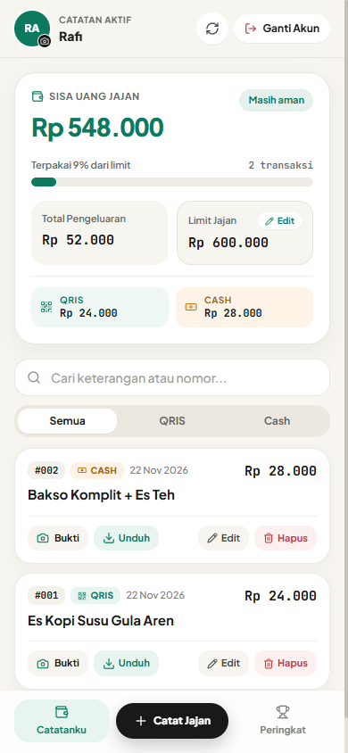
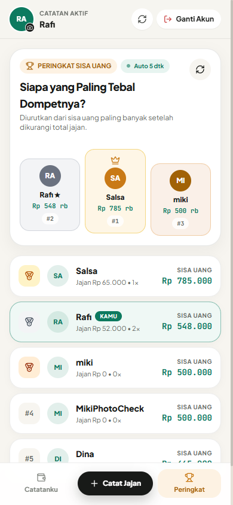

# JajanNote — Catatan Pengeluaran Harian & Leaderboard

**JajanNote** adalah aplikasi web pencatatan pengeluaran jajan harian berdesain **mobile-first / mobile-only responsive** yang dirancang dengan estetika buku saku modern (*tactile pocket ledger*). Dibangun menggunakan **React (Next.js App Router)**, **Framer Motion**, **Tailwind CSS**, dan **Neon Lakebase Postgres** untuk penyimpanan data real-time.

---

## Showcase

| Masuk Akun | Catatan Pengeluaran | Leaderboard Peringkat |
| :---: | :---: | :---: |
|  |  |  |

---

## Fitur Utama

- **Login Simpel Berbasis Nama** — Masuk atau daftar akun baru cukup menggunakan nama panggilan, lengkap dengan daftar akun terdaftar untuk berpindah akun dengan cepat.
- **Foto Profil Kustom** — Lingkaran profil di header dapat diketuk untuk mengganti, mengunggah, atau menghapus foto profil (tersimpan di database dan tampil di leaderboard).
- **CRUD Pengeluaran Lengkap** — Tambah, edit, dan hapus catatan pengeluaran dengan detail **Nomor Transaksi**, **Tanggal Beli**, **Keterangan**, **Harga (IDR)**, serta metode pembayaran **QRIS** atau **Cash**.
- **Upload & Download Bukti Pembayaran** — Mendukung unggah foto bukti transaksi QRIS/Cash (dengan kompresi otomatis) serta fitur **Unduh** foto bukti langsung atau kartu bukti pembayaran QRIS/Cash otomatis berformat PNG.
- **Ringkasan Keuangan & Edit Limit** — Menampilkan **Sisa Uang**, **Total Pengeluaran**, **Limit Jajan** yang dapat diubah kapan saja, progress bar pemakaian limit, serta rincian total QRIS vs Cash.
- **Pencarian & Filter Cepat** — Cari transaksi berdasarkan keterangan atau nomor, serta filter metode pembayaran (`Semua`, `QRIS`, `Cash`).
- **Leaderboard Sisa Uang (Auto-Refresh 5 Detik)** — Menampilkan peringkat seluruh akun dari sisa uang paling banyak, dilengkapi podium 3 besar dan pembaruan otomatis setiap 5 detik.
- **Layout Mobile-Only & Animasi Halus** — Tampilan fokus pada skala layar mobile (`max-width: 430px`) yang responsif di berbagai ukuran ponsel dengan animasi transisi dan bottom sheet berbasis **Framer Motion**.

---

## Tech Stack

- **Frontend:** React 19, Next.js 16 (App Router), Tailwind CSS v4, Framer Motion, Lucide Icons
- **Backend & Database:** Next.js Route Handlers, PostgreSQL (`pg` / Neon Lakebase Postgres)

---

## Environment Variables untuk Deploy di Vercel

Saat melakukan deploy project ini ke **Vercel** (*Project Settings → Environment Variables*), tambahkan variabel berikut:

| Nama Variabel | Wajib | Keterangan |
| --- | :---: | --- |
| `DATABASE_URL` | **Ya** | Connection string **pooled** Neon Postgres (host dengan akhiran `-pooler`) untuk query aplikasi. |
| `DATABASE_URL_UNPOOLED` | **Ya** | Connection string **direct / unpooled** Neon Postgres (tanpa `-pooler`) untuk inisialisasi & migrasi skema tabel otomatis. |
| `NEON_BRANCH` | Opsional | Nama branch Neon yang digunakan (default: `production`). |

> **Catatan:** Nilai `DATABASE_URL` dan `DATABASE_URL_UNPOOLED` dapat disalin langsung dari file `.env.local` lokal (hasil `neon deploy`) atau dari **Neon Console → Connection Details**. Pastikan mengaktifkan variabel tersebut untuk environment **Production** (dan **Preview** jika diperlukan).
