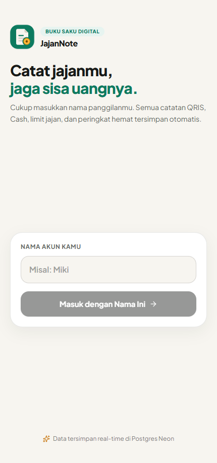

# JajanNote

**Catatan Pengeluaran Harian & Leaderboard Hemat**

Aplikasi web pencatatan pengeluaran jajan harian berdesain **mobile-only responsive** dengan estetika *pocket ledger* modern dan penyimpanan real-time di Neon Postgres.

 

---

## Pengenalan Project

**JajanNote** dirancang khusus untuk mencatat arus jajan harian secara cepat langsung dari layar ponsel (`max-width: 430px`). Setiap pengguna cukup masuk menggunakan nama panggilan untuk melacak pengeluaran **QRIS** dan **Cash**, memantau sisa anggaran terhadap limit yang dapat disesuaikan, mengunduh bukti transaksi, serta bersaing hemat pada papan peringkat secara real-time.

---

## Showcase

<table>
  <tr>
    <td align="center" width="33%">
      
       
      <b>Masuk Berbasis Nama</b>
    </td>
    <td align="center" width="33%">
      
       
      <b>Ringkasan &amp; Catatan Jajan</b>
    </td>
    <td align="center" width="33%">
      
       
      <b>Leaderboard Sisa Uang (Live 5 Detik)</b>
    </td>
  </tr>
</table>

---

## Fitur Utama

- **Login Simpel Berbasis Nama** — Masuk atau buat akun baru cukup menggunakan nama panggilan, lengkap dengan daftar akun terdaftar untuk berpindah akun dalam satu ketukan.
- **Foto Profil Kustom** — Lingkaran profil di header dapat ditekan untuk mengunggah, mengganti, atau menghapus foto profil (tersimpan di database dan tampil di leaderboard).
- **CRUD Pengeluaran Lengkap** — Tambah, edit, dan hapus catatan transaksi dengan kolom **Nomor Transaksi**, **Tanggal Beli**, **Keterangan**, **Harga (IDR)**, serta metode pembayaran **QRIS** atau **Cash**.
- **Upload & Download Bukti Pembayaran** — Mendukung unggah foto bukti QRIS/Cash (terkompresi otomatis) dan fitur **Unduh** foto bukti langsung atau kartu bukti pembayaran QRIS/Cash berformat PNG.
- **Ringkasan Keuangan & Edit Limit** — Menampilkan **Sisa Uang**, **Total Pengeluaran**, **Limit Jajan** yang dapat diubah kapan saja, progress bar pemakaian limit, serta rincian total **QRIS** vs **Cash**.
- **Pencarian & Filter Cepat** — Cari catatan berdasarkan keterangan atau nomor transaksi, serta filter metode pembayaran (`Semua`, `QRIS`, `Cash`).
- **Leaderboard Sisa Uang (Auto-Refresh 5 Detik)** — Peringkat seluruh akun berdasarkan sisa uang terbanyak, lengkap dengan podium 3 besar dan pembaruan otomatis setiap 5 detik.
- **Mobile-Only Responsive & Animasi Halus** — Antarmuka difokuskan untuk layar mobile dengan bottom sheet, tab indicator, dan animasi transisi berbasis **Framer Motion**.

---

## Tech Stack

| Kategori | Teknologi | Logo |
| --- | --- | --- |
| **Framework** | Next.js 16 (App Router) & React 19 |   |
| **Bahasa** | TypeScript |  |
| **Styling & Animasi** | Tailwind CSS v4, Framer Motion, Lucide Icons |   |
| **Database** | Neon Lakebase Postgres (`pg`) |  |

---

## Environment Variables untuk Deploy di Vercel

Saat melakukan deploy ke **Vercel** (*Project Settings → Environment Variables*), tambahkan variabel berikut untuk environment **Production** (dan **Preview** jika diperlukan):

| Nama Variabel | Status | Keterangan |
| --- | :---: | --- |
| `DATABASE_URL` | **Wajib** | Connection string **pooled** Neon Postgres (hostname berakhiran `-pooler`) untuk seluruh query aplikasi. |
| `DATABASE_URL_UNPOOLED` | **Wajib** | Connection string **direct / unpooled** Neon Postgres (tanpa `-pooler`) untuk inisialisasi dan migrasi skema tabel otomatis. |
| `NEON_BRANCH` | Opsional | Nama branch Neon yang digunakan (default fallback: `production`). |

> **Catatan:** Nilai `DATABASE_URL` dan `DATABASE_URL_UNPOOLED` dapat disalin langsung dari file `.env.local` lokal atau dari **Neon Console → Connection Details**.
